<div align="center">

# Omarchy Cyberpunk

**Bring Night City to your Omarchy desktop.**

Neon accents. Angular interfaces. A Cyberpunk setup you control.


<a href="docs/media/desktop.png">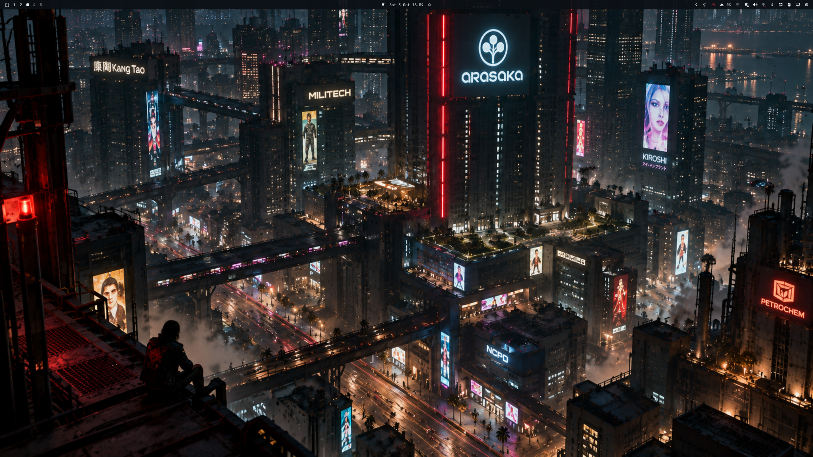</a>

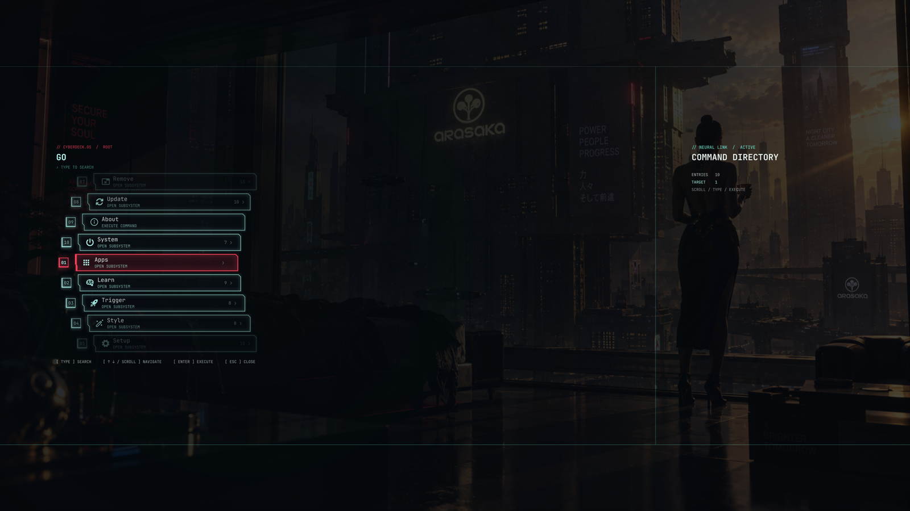

</div>

https://github.com/user-attachments/assets/2f13bbd8-1528-4b66-b1b4-9676b275b185

*60-second continuous presentation · 1440p / 60 FPS · Omarchy's native foundations, your own Cyberpunk component mix.*

## The desktop, in red and turquoise

Cyberpunk-inspired presentation built around **Omarchy's native shell and theme
picker**. The palette, menu and authentication surfaces share the same visual
language: angular frames, curved HUD rows, translucent red fields, turquoise
highlights and frozen-background signal faults.

## Showcase

<table>
  <tr>
    <td width="50%" align="center"><b>Command HUD · 06</b><br><a href="docs/media/menu.png">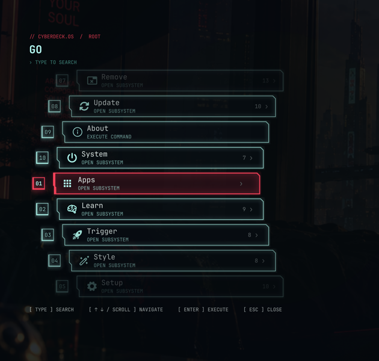</a></td>
    <td width="50%" align="center"><b>Apps · 07</b><br><a href="docs/media/apps.png">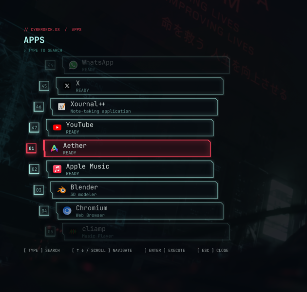</a></td>
  </tr>
  <tr>
    <td align="center"><b>Keybindings · 09</b><br><a href="docs/media/keybindings.png">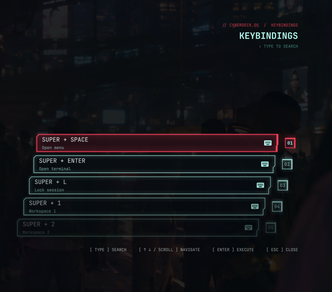</a></td>
    <td align="center"><b>Notifications · 10</b><br><a href="docs/media/notifications.png">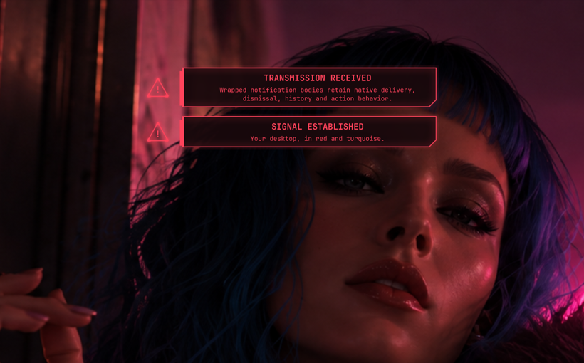</a></td>
  </tr>
  <tr>
    <td align="center"><b>Volume · 12</b><br><a href="docs/media/volume.png"></a></td>
    <td align="center"><b>Mute · 12</b><br><a href="docs/media/mute.png"></a></td>
  </tr>
</table>

### In motion

<table>
  <tr>
    <td width="50%" align="center"><b>Menu navigation</b><br>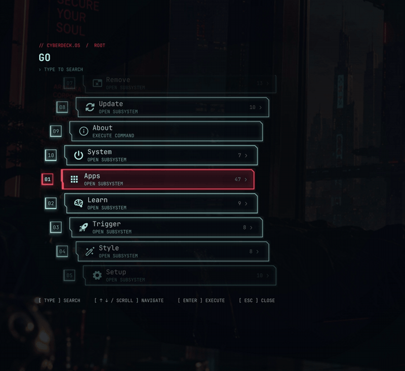</td>
    <td width="50%" align="center"><b>Authentication signal faults</b><br>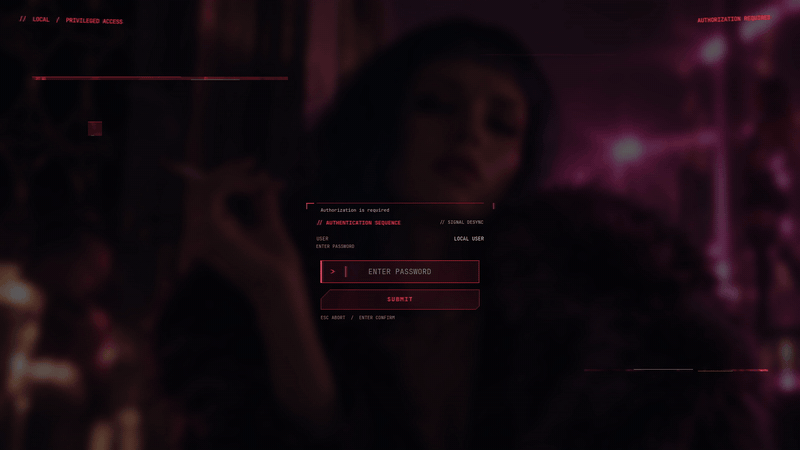</td>
  </tr>
</table>

### Matching authentication

<table>
  <tr>
    <td width="33%" align="center"><b>Session lock · 12</b><br><a href="docs/media/lock.png">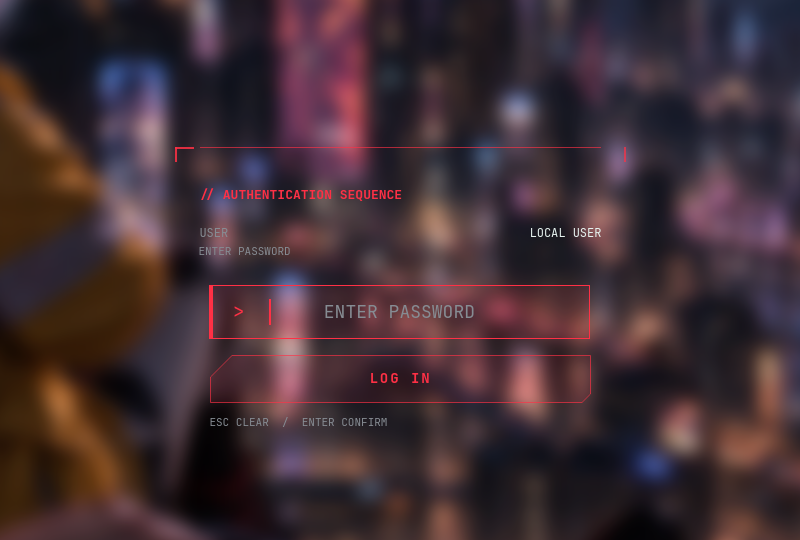</a></td>
    <td width="33%" align="center"><b>Sudo · 09</b><br><a href="docs/media/sudo.png">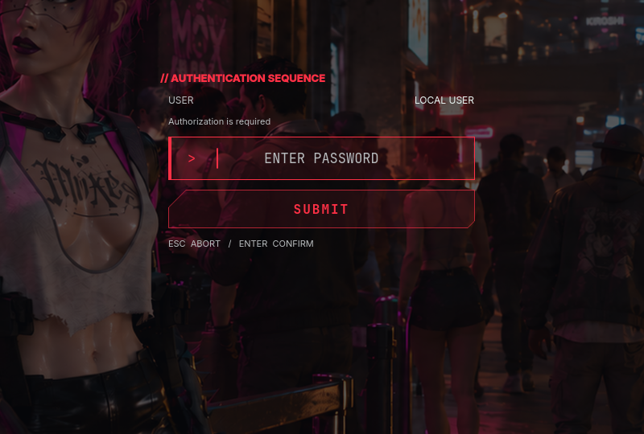</a></td>
    <td width="33%" align="center"><b>Polkit · 10</b><br><a href="docs/media/polkit.png">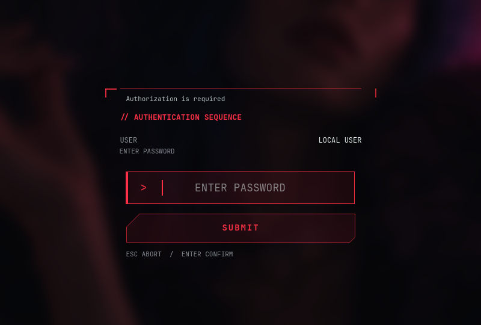</a></td>
  </tr>
</table>

The opening desktop shot shows the live Omarchy bar with the author's configured
widgets; bar layout and third-party widgets are personal choices, not bundled defaults.
Component views are actual QML captured in a clean private preview session;
shortcut rows and notifications use illustrative data. Auth views are offline
appearance demos, with no real credentials or authentication requests. Optional
components are shown enabled for the showcase; **fresh installs are base-only**.

The presentation is one continuous live take: wallpaper 06, menu/submenu browsing,
Ghostty search and launch, installer logo and component-status terminals at normal
font size, window borders and scheme inversion, wallpaper carousel to 11, one sample
notification, gradual volume/mute/unmute OSD, and real Polkit failure/retry/success.
Mouse pointer and audio are excluded. Demonstration messages/OSD values are
controlled; actual audio is unchanged.

[Full-resolution motion clips and reproduction details →](docs/media/README.md)

## Components

| Component | What you get |
| --- | --- |
| **Desktop** | Palette-derived shell colors, directional window borders and 13 bundled wallpapers. |
| **Menu** | Curved command/App rows, search, stable hover, wheel navigation and mirrored Keybindings. |
| **Notifications** | Top-centered warning banners with the Cyberpunk blink/reveal/unreveal sequence and theme accents at every urgency. Native 4.5 stacks, DND, history and links; action buttons appear on hover or keyboard selection. |
| **OSD** | Turquoise volume, red mute and centered action messages; native brightness, media and microphone payloads. |
| **Sudo / Polkit** | Frozen/dimmed backdrop, beveled password masks, a single padded red caret and cut-corner actions. |
| **Session lock** | Matching wallpaper/prompt and a brief settling effect, with pinned native PAM and secure session-lock handling. |

Sudo/Polkit shuffle 0.85/1.10/1.40-second fault sequences with varied pauses.
`OMARCHY_REDUCED_MOTION=1` suppresses their cosmetic loops. Passwords stay in the
native authentication flow; diagnostic IPC and review captures do not carry them.

## Wallpapers

[`theme/backgrounds/`](theme/backgrounds/) contains the author's **13 generated
wallpapers**, copied without resizing or recompression:

```text
01.png  02.png  03.png  04.png  05.png  06.png  07.png
08.png  09.png  10.png  11.png  12.png  13.png
```

All bundled wallpapers are **1672 × 941**, copied byte-for-byte from the supplied
files. Numbering preserves their order in Omarchy's
background picker. **`01.png` is the installation default** and the source for the
theme thumbnail and offline auth previews.

<a href="docs/media/wallpapers.png">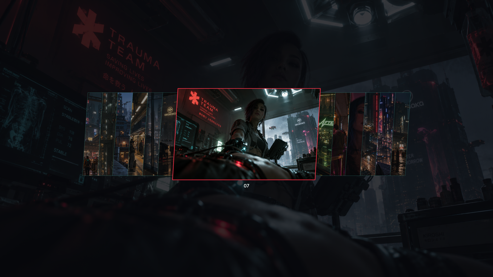</a>

Use **Appearance → Background** in the Omarchy menu, or cycle with:

```sh
omarchy theme bg next
```

Additional personal backgrounds can go in `~/.config/omarchy/backgrounds/cyberpunk/`.
Omarchy includes those alongside the bundled collection.

## Requirements

- **Omarchy 4.5.0-3** in a running Hyprland/Wayland session.
- Omarchy's Quickshell/Qt 6 environment, Python/PySide6, Bash, `jq`, `flock` and `grim`.
- An unlocked, PAM-ready session with stock menu, Polkit, notifications, OSD and
  lock plugins enabled before first installation.
- `curl` for release installation and updates.

Pillow, FFmpeg and ImageMagick are only needed for development preview/thumbnail tooling.

The session-lock generator checks the inspected upstream release. An Omarchy
update that changes that contract needs review before custom-lock activation.

[Omarchy compatibility tracking and upgrade procedure →](docs/COMPATIBILITY.md)

**Upgrading from Omarchy 4.0:** keep Cyberpunk v0.1.6 until the system upgrade.
Switch to a bundled theme first (preferences are retained), update Omarchy using
its stable system updater, then run `cyberpunk update` and select Cyberpunk again.
The installer rejects a different Omarchy package or changed reviewed sources
before removing the existing installation. Custom lock activation remains gated
by safe mode and needs separate lock/unlock acceptance.

The Cyberpunk menu keeps Apps inside its application-index HUD instead of the
4.5 dock launcher. This follows the existing menu component switch:
`cyberpunk disable menu` or selecting a regular theme restores the stock route;
`cyberpunk enable menu` restores the integrated Apps view on Cyberpunk. Explicit
user menu actions still take precedence. No global menu override is installed.

For a **supervised lock trial**, keep recovery access available, then use
`cyberpunk lock status` and `cyberpunk lock trial` while unlocked. Trial only
selects the custom provider; it does not lock the screen. Test locking and
unlocking manually. Once unlocked, `cyberpunk lock restore` returns to the stock
provider. Safe mode stays intact, and updates/uninstallation refuse an armed
trial. Do not restart the shell or swap providers during a secure lock.

Cyberpunk v0.1.5 adds `cyberpunk compatibility [--upstream] [--json]`
and a general source audit to `cyberpunk check`. The repository's daily release
monitor opens a review issue when a newer stable Omarchy release appears.

## Install

Install the latest versioned release with one command, as your desktop user:

```sh
curl -fsSL https://raw.githubusercontent.com/LightQv/omarchy-cyberpunk/main/install.sh | bash
cyberpunk status
cyberpunk check
```

**No Git checkout or sudo required.** The bootstrap downloads a tagged GitHub release,
verifies its SHA-256 checksum and file manifest, installs it, and removes the temporary
download. Existing checkout installations migrate with their saved choices preserved.

Wide UTF-8 terminals show the supplied Cyberpunk Braille logo before downloading.
Its fixed true-color turquoise is **`#53e3d2`**, independent of terminal theme colors.
Narrow terminals and redirected output use a compact caption. `NO_COLOR` or a
terminal without advertised true-color support uses plain text.

After the release is verified, **first-time interactive installation** asks for:

1. **Base theme only** — palette, wallpapers and borders (default).
2. **Full stack** — all six optional presentation preferences enabled.
3. **Custom** — choose menu, notifications, OSD, sudo, Polkit and lock individually.

Selections are shown for confirmation and applied together. The final summary
reports saved choices and actual providers; stock lock remains active while safe
mode is on, even if full/custom setup requests the themed lock. Updates, repeat
installations and reinstalls with retained preferences preserve choices without
prompting again. Interactive answers come from `/dev/tty`, not the piped script.

Unattended first installation defaults to base-only. Explicit first-install options:

```sh
curl -fsSL https://raw.githubusercontent.com/LightQv/omarchy-cyberpunk/main/install.sh | bash -s -- --setup full --non-interactive
curl -fsSL https://raw.githubusercontent.com/LightQv/omarchy-cyberpunk/main/install.sh | bash -s -- --components menu,notifications,osd --non-interactive
```

Setup overrides are refused on existing installations; change those choices with
`cyberpunk enable|disable` instead. At completion, use `cyberpunk status` to inspect
the current state and `cyberpunk --help` for all component-management commands.

| Installed content | Location |
| --- | --- |
| Theme and wallpapers | `~/.config/omarchy/themes/cyberpunk/` |
| Optional plugins | `~/.config/omarchy/plugins/lightqv.cyberpunk-*/` |
| CLI and shared support code | `${XDG_DATA_HOME:-~/.local/share}/omarchy-cyberpunk/` |
| Command | `~/.local/bin/cyberpunk` |
| Preferences, lock safeguards and release recovery | `${XDG_STATE_HOME:-~/.local/state}/omarchy-cyberpunk/` |

Theme and plugin directories contain installed files, not links to a development
checkout. Shared support code stays installed until uninstall. Ensure `~/.local/bin/`
is on your `PATH`. Open a new terminal or source `~/.bashrc` after installation.

```sh
cyberpunk version
cyberpunk update
```

Repeated installation of the same release validates it without changing installed
files or desktop settings. Updates preserve component
preferences, the selected theme and wallpaper. Edited or added project files are
protected: preserve your changes and restore the release files before updating or
removing. Interrupted transactions retain a private recovery journal; rerun the
installer while unlocked to recover and retry.

This release targets the inspected Omarchy version; pristine live
new-user/machine installation remains a qualification under **Validation and limitations**.

<details>
<summary>Installation details</summary>

Installation adds an exact interactive-Bash sudo stanza and desktop
`theme-set`/`post-boot` reconciliation hooks. Theme selection can restart OpenCode.

First install creates a private baseline at
`~/.local/state/omarchy-cyberpunk-backup/{shell.json,bashrc,modes.json}`.
Existing complete baselines are retained. Incomplete/untrusted baselines and
occupied foreign paths are refused before installation changes the desktop.

</details>

## Usage and customization

Select **Cyberpunk** through Omarchy's normal theme picker. Other themes restore
native desktop services. The project follows your existing Omarchy keybindings.

### One command, six optional components

**Base-only is the fresh-install default:** palette, wallpapers and borders with
native menu, notifications, OSD, sudo, Polkit and lock presentation. The installer
can select your optional components up front; you can change them afterward from
any directory:

```sh
cyberpunk --help
cyberpunk list
cyberpunk status
cyberpunk enable menu
cyberpunk disable menu
cyberpunk enable all
cyberpunk disable all
```

Toggle names: `menu`, `notifications`, `osd`, `sudo`, `polkit`, `lock` — or `all`.

`--help` explains the commands and gives examples. `list` describes the toggleable
components; `status` reports your saved choices and actual providers. Help, list,
status and check are read-only.

**Enable** selects Cyberpunk presentation; **disable** restores native
presentation while keeping the functionality available. `osd` includes the volume,
mute, brightness, microphone and media popups. The audio panel/bar widget remains
independent of this project.

`all` updates all six preferences together. These commands do not select a theme.
Switching to a native theme uses native components; switching back to Cyberpunk
restores your last component choices. `repair` follows these choices instead of
enabling every component.

Preferences are stored under `XDG_STATE_HOME`, defaulting to
`~/.local/state/omarchy-cyberpunk/preferences.json`, outside the checkout, and
retained across removal/reinstallation. Existing installations
migrate their current Cyberpunk component selection and legacy lock preference;
fresh defaults do not reset an existing installation.

### Session lock

`cyberpunk enable lock` saves the choice but respects **lock safe mode**. Status
shows both the saved preference and actual provider, including blocked/pending
activation. An active secure lock stays intact; provider changes wait until
unlock. Safe-mode clearance remains a separate development acceptance gate.

The public CLI also supports supervised custom-lock validation:

```sh
cyberpunk lock status
cyberpunk lock trial
cyberpunk lock restore
```

Keep recovery-terminal access available before starting a trial. Run `trial`
only while unlocked and PAM-ready; it selects the custom provider without
locking the screen or clearing safe mode. Test locking and unlocking manually,
then run `restore` while unlocked to end the trial and restore the stock provider.
Updates and uninstallation are blocked while a trial is armed. Never restart the
shell or change providers during a secure lock. A successful trial does not
permanently enable the custom lock or clear safe mode.

### Sudo and Polkit

Open a new interactive Bash terminal after installation or upgrade, or source
`~/.bashrc` once. Afterward, loaded integration reads the sudo preference on each
invocation. Graphical sudo is used when its preference is enabled and Cyberpunk is
selected in a Wayland terminal. Off-theme, scripted sudo,
`sudo -n` and `sudo -S` retain native routing. Polkit keeps its native agent/PAM flow.

### Palette

Invert the red/turquoise **interface roles** without manually editing theme files:

```sh
cyberpunk scheme status
cyberpunk scheme toggle
cyberpunk scheme set inverted
cyberpunk scheme set default
```

The scheme is saved independently of component choices and survives updates,
theme switching and reinstall. Terminal ANSI colors, wallpaper and component
preferences stay unchanged. When Cyberpunk is selected, shell colors and window
borders refresh directly; this does **not** invoke Omarchy's full theme-switch
hooks or send OpenCode its reload signal. Off-theme, the choice is saved for
the next Cyberpunk selection. New sudo prompts follow the scheme too.

Change schemes while unlocked with no authentication dialog open. Active lock or
authentication requests block the command. Modified installed files are still
protected; supported scheme generation is recorded as project-owned output.

For palette development, edit `theme/colors.toml` in the checkout and render it:

```sh
scripts/render-palette --write
./dev preview
```

This previews the checkout; the installed release stays independent. Reapplying
Cyberpunk through Omarchy selects the installed palette, not the edited checkout.
Release updates deliberately protect modified installed files.

Omarchy's normal theme/background switching semantics still apply. To explicitly
return to the default wallpaper:

```sh
omarchy theme bg set "$HOME/.local/state/omarchy/current/theme/backgrounds/01.png"
```

## Recovery and removal

Inspect or reconcile the selected theme and saved choices:

```sh
cyberpunk check
cyberpunk repair
```

Remove while unlocked:

```sh
cyberpunk uninstall
```

Removal restores native plugins and the recorded prior theme, removing project-owned
installed theme/plugin/runtime files, hooks, the CLI link and exact Bash stanza.
Preferences and private backups are retained. Foreign files, edited markers and
different active clones are protected. Development checkouts remain untouched.

## Validation and limitations

Cyberpunk **v0.2.6** passed **97 regression tests** on **Omarchy 4.5.0-3**.
Live acceptance covered notification presentation, integrated Apps, preserved
shortcuts, fresh login, custom-lock authentication, repeated lock/unlock and
suspend/resume on the inspected setup.

Pristine live first installation, physical extra-output/scale configurations,
trackpad, fingerprint and unsupported authentication flows remain unqualified.
Stock lock remains the fresh-install safe-mode default. Earlier suspend-focus
observations and detailed validation history are recorded in the
[compatibility guide](docs/COMPATIBILITY.md#validation-history-and-scope).

Boot/disk unlock and display-manager login remain managed by Omarchy; this
project covers desktop/session authentication presentation.

## Development

### Develop while using the release

Keep the checkout under `~/Projects/omarchy-cyberpunk/` and edit it normally. The
installed `cyberpunk` command continues to use the release; checkout edits do not
change your daily desktop.

```sh
./dev test
./dev preview                      # Offline lock/sudo/Polkit previews
./dev preview desktop              # Private desktop-component preview
./dev preview installer            # Real banner/prompts, simulated installation
./dev preview installer --setup full --non-interactive
./dev build                        # Local v0.0.0 archive, not installed/published
./dev build v0.1.5                  # Explicit local candidate version
```

Generated previews remain under ignored `preview/` and `showcase/`; local archives
and checksums go to ignored `dist/dev/`. Renderer options can follow the preview
type, for example `./dev preview auth --lock-wallpaper 11.png`. Stage any new runtime
files in Git before building so the packager includes them.

Installer preview reads the same choices from the terminal but makes no network
requests and writes no preferences or installed files. You can also preview a
custom selection with `./dev preview installer --components menu,osd --non-interactive`.

Production and development providers share IDs, so a complete live development
installation belongs in a **separate Omarchy user/session or VM**. Tests use an
isolated HOME/native-API simulator, auth previews never authenticate, and the private
desktop preview only covers the display temporarily.

<details>
<summary>Development checkout installation</summary>

```sh
git clone https://github.com/LightQv/omarchy-cyberpunk.git
cd omarchy-cyberpunk
scripts/install-dev
```

This development mode links files to the checkout, which must remain in place.
Use it on an uninstalled setup; the release installer can migrate it later.

</details>

Offline auth tooling defaults to `01.png`, supports per-view wallpaper choices and
never authenticates or registers secure surfaces.

The showcase uses `06`, `07`, `09`, `10`, `11` and `12`. See
[media reproduction instructions](docs/media/README.md) for the exact renderer
commands and source/artwork hashes. Working captures stay local and ignored.

## Credits

- **Omarchy / Quickshell / Hyprland** — native platform and upstream components.
- **CyberArch-Shell** — visual inspiration for menu presentation; its code/artwork
  is not bundled.
- **Cyberpunk 2077 / CD PROJEKT RED** — aesthetic inspiration.

See [THIRD_PARTY.md](THIRD_PARTY.md) and [LICENSE](LICENSE) for provenance and notices.
Unofficial fan-made project; not affiliated with CD PROJEKT RED.
